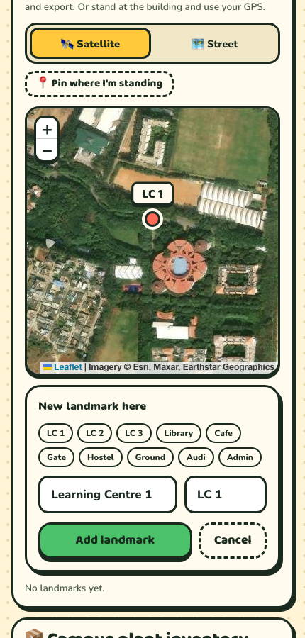

<h1 align="center">Canopy Quest</h1>

<b>Hunt leaves. Snap them. Top the canopy.</b> 
A live, geotagged campus species hunt built for the Centre of Excellence for Nature Based Solutions, Alliance University.

  

  
  
  
  
  
  
  

  
  
  
  
  

---

## What it is

Students roam campus with their phones and photograph leaves, flowers and trees. Each photo is **geotagged inside the site** the moment it's taken, **checked by a plant-identification AI**, **confirmed by judges from the CoE**, and lands on a **live leaderboard** on the big screen. When the hunt ends, the organisers walk away with a **geotagged inventory of the campus's plants**.

It runs in any phone browser from a QR code. No app store, no install, iPhone and Android alike.

## Why it exists

The CoE wanted a contest where students search campus for different plant species and upload geotagged photos, with a live leaderboard. The usual tools fall apart for that: a form or a group chat can't verify a species, can't trust a location (most phones strip GPS from uploaded photos), can't score live, and leaves behind a pile of unsorted photos. Canopy Quest turns the brief into a game that verifies itself and produces real field data as a side effect.

The full story, constraints and trade-offs: **[docs/STORY.md](docs/STORY.md)**.

## How it plays

| | |
|---|---|
| 📲 **Scan & join** | Student ID + 4-digit PIN. Play solo, or form a team of up to 4. Both leaderboards run at once. |
| 📸 **Snap** | The site locks your GPS, checks you're inside the campus hunt zone, and burns a geotag stamp (coordinates, time, name) onto the photo. |
| 🤖 **Ask Sprig** | Pick the species, or let the AI name it. When the AI agrees, points are instant. When it doesn't, a judge decides. |
| 📖 **Herbarium** | 58 campus plants, shown as silhouettes with riddles until you find them. Each find unlocks a fact. |
| 🎯 **Live events** | Organisers launch timed WANTED bounties (×2), freeze the leaderboard for the final stretch, and reveal the winners on the projector. |

**Scoring:** Common 10 · Uncommon 20 · Rare 40 · Legendary 80 · 🥇 First on campus +50% · 🎯 WANTED ×2. Each species counts once per player and once per team.

## The big screen

Team and solo leaderboards, a campus map that fills with pins, a live photo feed with first-finder ribbons, WANTED banners, celebrations for legendary finds, a ticker of plant facts and nature-based-solution stats (native, pollinator, medicinal and invasive species spotted), and a dramatic final reveal.

## For judges and organisers

  
  
  

- **Judge queue** on any phone: the photo, what the player claimed, what the AI thinks (with confidence), flags, location. Approve, reject or correct the species in one tap.
- **Admin panel:** hunt times and geofence, campus landmarks placed on a satellite view, WANTED bounties, freeze and reveal, species editor, player management, an AI on/off switch, and a one-click export of every find as CSV or GeoJSON.

## Documentation

| | |
|---|---|
| [STORY.md](docs/STORY.md) | Why it was built, what problem it solves, constraints, decisions and lessons |
| [HOW-IT-WORKS.md](docs/HOW-IT-WORKS.md) | The full game: journey, scoring, verification, anti-cheat, live events |
| [ARCHITECTURE.md](docs/ARCHITECTURE.md) | System design, data model, security model, performance and free-tier budget |
| [DESIGN.md](docs/DESIGN.md) | The cartoon field-guide look, Sprig, and the screens |
| [SPECIES.md](docs/SPECIES.md) | All 58 plants, their rarity, tags, and how the names were checked against the AI |
| [ORGANISER-GUIDE.md](docs/ORGANISER-GUIDE.md) | Running an event: before, during and after |

---

MIT licensed. A side project by <a href="https://github.com/sidhy4rth">Sidhyarth</a>, built for the CoE for Nature Based Solutions, Alliance University, Bengaluru. 
Plant identification by <a href="https://my.plantnet.org">Pl@ntNet</a> · Map data © <a href="https://www.openstreetmap.org/copyright">OpenStreetMap</a> contributors.

