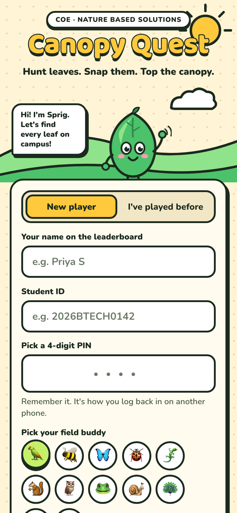
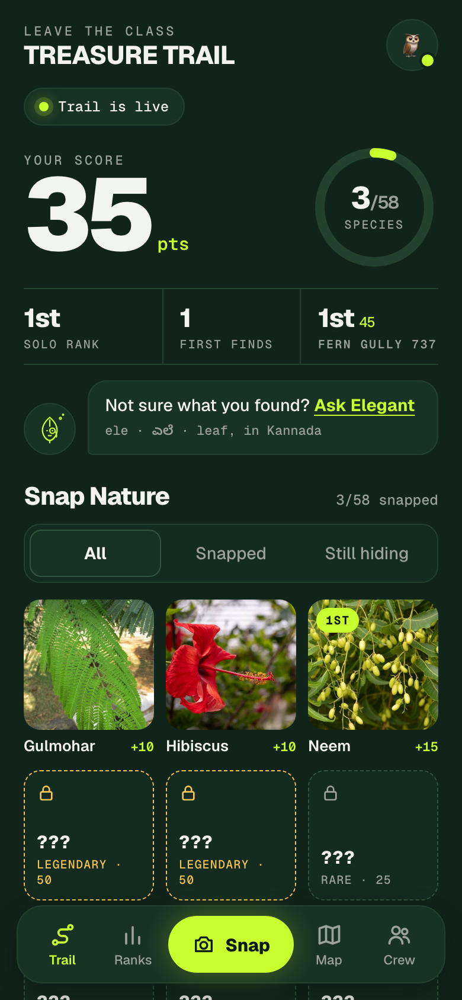
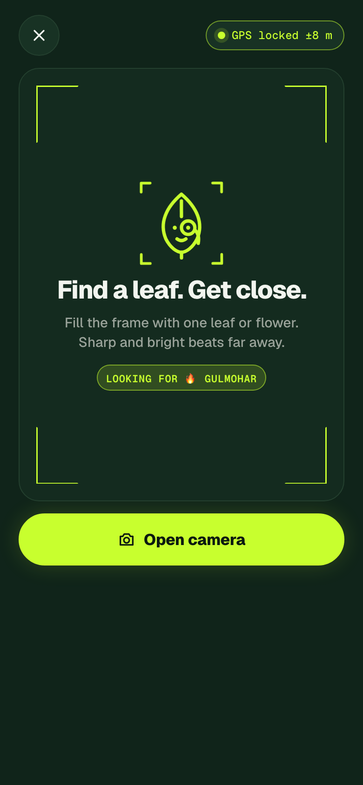
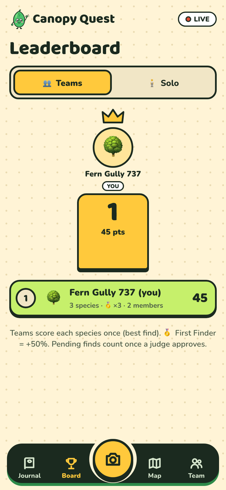
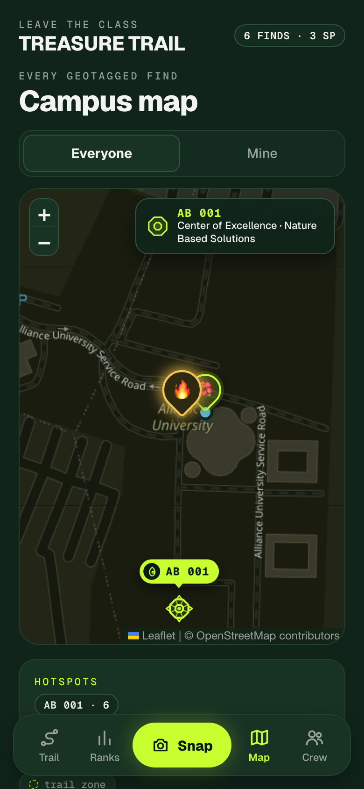
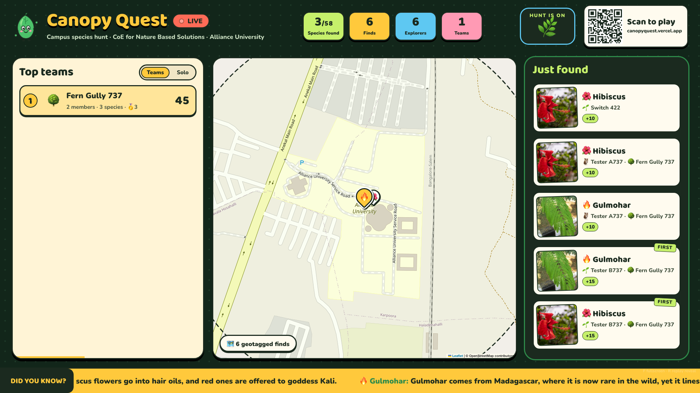
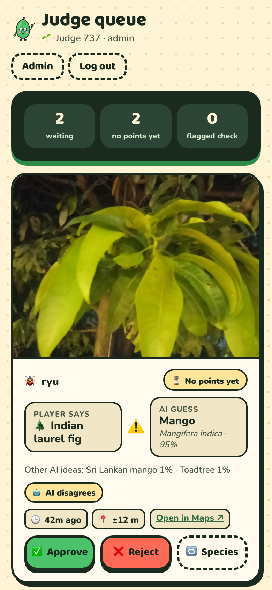
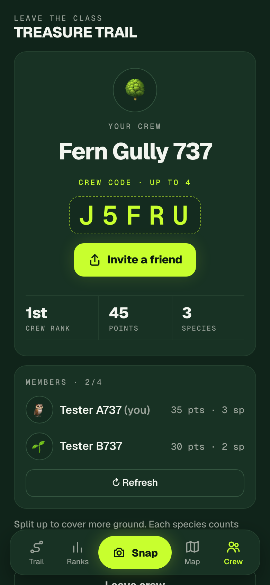

LEAVE THE CLASS

<h1 align="center">TREASURE TRAIL</h1>

<b>Leave the class. Discover the biodiversity along campus. Snap it.</b> 
A live, geotagged campus biodiversity trail for Alliance University, Bengaluru.

  

  
  
  
  
  
  
  

  
  
  
  
  

---

## What it is

**TREASURE TRAIL** is part of **Leave the Class**, a series that gets students out of the classroom and onto campus. Students walk the campus with their phones and photograph leaves, flowers and trees. Every photo is **geotagged inside the site** the moment it's taken, **identified by a plant AI**, **confirmed by judges**, and lands on a **live leaderboard** on the big screen. When the trail closes, the organisers have a **geotagged inventory of the campus's plants**.

It runs in any phone browser from a QR code. No app store, no install, iPhone and Android alike.

## Why it exists

The brief: students search campus for different plant species and upload geotagged photos, with a live leaderboard. The obvious tools fall apart. A form or a group chat can't verify a species, can't trust a location (most phones strip GPS from uploaded photos), can't score live, and leaves a pile of unsorted photos behind. TREASURE TRAIL turns the brief into a game that checks itself and produces real field data as a side effect.

The full story, constraints and trade-offs: **[docs/STORY.md](docs/STORY.md)**.

## How it plays

| | |
|---|---|
| **Scan & join** | Registration number + 4-digit PIN. Play solo, or form a crew of up to 4. Both leaderboards run at once. |
| **Snap** | The site locks your GPS, checks you're inside the campus trail zone, and burns a geotag stamp (coordinates, time, name) onto the photo. |
| **Ask Elegant** | Pick the species, or let **Elegant**, the trail's guide, name it with the plant AI. When the AI agrees, points are instant. When it doesn't, a judge decides. |
| **Snap Nature** | 58 campus plants, shown as locked tiles with riddles until you snap them. Each find unlocks a fact. |
| **Live moments** | Organisers launch timed bounties (×2), freeze the leaderboard for the final stretch, and reveal the winners on the projector. |

**Scoring:** Common 10 · Rare 25 · Legendary 50 · First on campus +50% · plus surprise bounties (×2) launched live by organisers. Each species counts once per player and once per crew.

### Meet Elegant

**ELE·gant**: *ele* (ಎಲೆ) is Kannada for **leaf**. Elegant is a leaf wearing a monocle. Snap something you can't name and it tells you what it is.

 

## The big screen

Crew and solo leaderboards, a campus map that fills with pins, a live photo feed with first-finder tags, bounty banners, celebrations for legendary finds, a ticker of plant facts and biodiversity stats (native, pollinator, medicinal and invasive species spotted), and a dramatic final reveal.

## For judges and organisers

  
  
  

- **Judge queue** on any phone: the photo, what the player claimed, what the AI thinks (with confidence), flags, location. Approve, reject or correct the species in one tap.
- **Admin panel:** trail times and geofence, campus landmarks placed on a satellite view, bounties, freeze and reveal, a species editor, player management, an AI on/off switch, and a one-click export of every find as CSV or GeoJSON.
- **Campus landmarks** appear on every map. The Centre of Excellence for Nature Based Solutions headquarters (**AB 001**) is drawn as a to-scale sketch of its octagonal building, with a legend.

## Documentation

| | |
|---|---|
| [STORY.md](docs/STORY.md) | Why it was built, what problem it solves, constraints, decisions and lessons |
| [HOW-IT-WORKS.md](docs/HOW-IT-WORKS.md) | The full game: journey, scoring, verification, anti-cheat, live moments |
| [ARCHITECTURE.md](docs/ARCHITECTURE.md) | System design, data model, security, performance and edge caching |
| [DESIGN.md](docs/DESIGN.md) | After Dark in forest green, Elegant, and how the redesign happened |
| [SPECIES.md](docs/SPECIES.md) | All 58 plants, their rarity, tags, and how the names were checked against the AI |
| [ORGANISER-GUIDE.md](docs/ORGANISER-GUIDE.md) | Running a trail: before, during and after |

---

MIT licensed. A side project by <a href="https://github.com/sidhy4rth">Sidhyarth</a> for Leave the Class at Alliance University, Bengaluru. 
Plant identification by <a href="https://my.plantnet.org">Pl@ntNet</a> · Map data © <a href="https://www.openstreetmap.org/copyright">OpenStreetMap</a> contributors.

