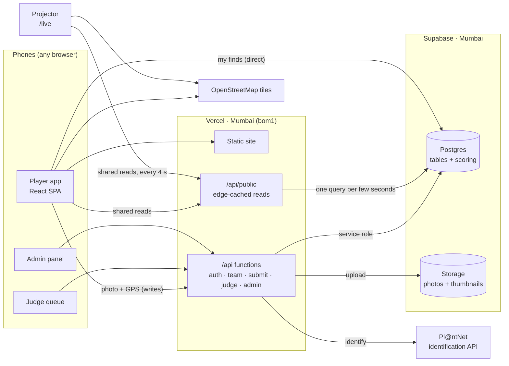
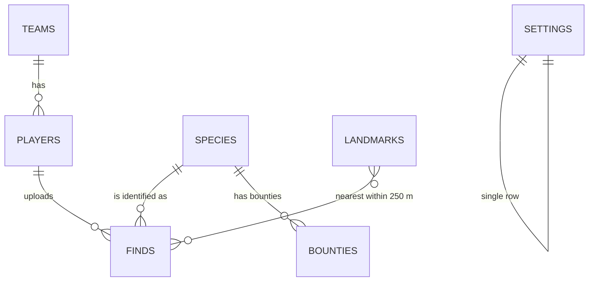
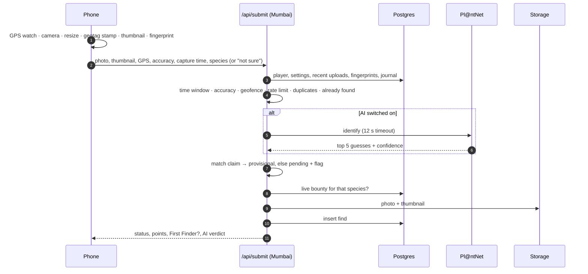

# Architecture

## At a glance



**One rule holds the whole thing together: browsers only ever read; every write goes through the server.** The database has row-level security switched on for every table and *no* policies that let a browser write anything. The public key in the browser can only call a handful of read functions that return game state. All changes (joining, uploading, judging, admin actions) go through Vercel functions that verify the player and use the privileged key on the server.

## Stack

| Layer | Choice | Why |
|---|---|---|
| Front end | React 19, TypeScript, Vite, React Router | A fast single-page app that works in every phone browser. Pages are lazy-loaded so the first screen is light. |
| Maps | Leaflet + OpenStreetMap tiles; Esri satellite imagery in the admin landmark tool | Free, no API keys, good enough zoom for a campus. |
| Server | Vercel Functions (Node), pinned to Mumbai | Same project as the site, no servers to run. Pinned next to the database so an upload's several database calls don't cross continents. |
| Edge cache | Vercel CDN in front of `/api/public` | Shared game data (leaderboards, feed, map, landmarks, species) is cached for a few seconds at the edge, so a hundred phones cost the database one query instead of a hundred. |
| Database | Supabase Postgres | Scoring is a few joins and window functions, which SQL does better and faster than application code. |
| File storage | Supabase Storage (public bucket of JPEGs) | Same provider as the database; photos are meant to be shown on the projector anyway. |
| Plant ID | Pl@ntNet API v2 | Purpose-built botanical identification with confidence scores, free for non-commercial use. |
| Extras | canvas-confetti, qrcode, idb-keyval | Celebrations, the projector's QR code, and the offline upload queue. |

## Data model



| Table | What it holds |
|---|---|
| `settings` | One row: event name, start and end, trail-zone centre and radius, GPS accuracy limit, leaderboard freeze time, AI on/off. |
| `players` | Name, registration number (unique), scrypt-hashed PIN, team, role (player / judge / admin), avatar, failed-login counter and lock. |
| `teams` | Crews in the UI. Name (unique, case-insensitive), 5-character crew code, emoji. |
| `species` | Common and scientific name, accepted alternative names (incl. `Genus *` wildcards), kind, rarity, points, emoji, riddle, fun fact, tags, active flag. |
| `finds` | Player, final species and claimed species, photo and thumbnail URLs, latitude, longitude, accuracy, capture time, upload time, the AI's top guess, score, match and raw top-5, status (provisional / pending / approved / rejected), flags, image fingerprint, bounty multiplier, judge and note. |
| `bounties` | Species, multiplier, start, end. |
| `landmarks` | Name, short label, latitude, longitude, featured flag (the CoE headquarters, drawn as a building sketch with a legend). |

### Scoring lives in the database

`scored_finds(cutoff)` returns one row per *counted* find with its points: rarity points × bounty multiplier × 1.5 if it's the earliest counted upload of that species. It's a function, not stored data, so judge decisions, reassignments and the freeze all just work: change a find's status and every score, rank and First Finder recomputes on the next read.

Public read functions (all `security definer`). The shared ones are served through the edge-cached `/api/public` proxy, with a direct call to the database as a fallback:

| Function | Used by | Returns |
|---|---|---|
| `game_state()` | Every screen, every 4–15 s (edge cache: 3 s) | Settings, both leaderboards (as of the freeze time if frozen), found-species stats with first finders, the live bounty, totals. About 23 KB at full event size. |
| `feed(n)` | Projector (edge cache: 3 s) | Latest counted finds with photo, player, team, points (hidden while frozen), first-finder flag, nearest landmark. |
| `map_points()` | Maps (edge cache: 15 s) | Every counted find's position, species and nearest landmark. |
| `my_finds(pid)` | Trail home (direct, not cached) | One player's finds in any status, with points. Reads only that player's rows. |
| `species_list()` | Everywhere (edge cache: 120 s) | Active species. Cached on the phone, refreshed every 2 minutes. |
| `landmarks_state()` | Maps, projector (edge cache: 30 s) | Landmarks and the top 5 hotspots. |

## The upload pipeline



If the network fails before the server answers, the phone keeps the whole request (with its original GPS and time) in IndexedDB and retries.

## Security model

| Concern | How it's handled |
|---|---|
| Who can write | Only the server, with the privileged key held in Vercel's encrypted settings. Row-level security is on for every table with no write policies. |
| Who can read what | Browsers call a fixed set of read functions. Registration numbers and PIN hashes are never returned by any public function. |
| Sign-in | Registration number + 4-digit PIN, hashed with scrypt and a per-player salt. Sessions are HMAC-signed tokens (7-day expiry) checked against the database on every call. 8 wrong PINs lock the ID for 10 minutes. |
| Why not a hosted auth service | Hosted sign-up limits are per IP address; a whole campus behind a few IPs would hit them in the first minute. Email sign-in wasn't an option either (free-tier email limits are tiny, and nobody wants to check email mid-event). |
| Staff access | Judge and admin roles are granted by entering a staff code, checked on the server. Every judge/admin action re-checks the role in the database. |
| Fake locations | GPS comes from the browser at capture time, with accuracy and geofence checks on the server. (A determined player can spoof GPS with developer tools; the judge queue, duplicate detection and AI cross-check are the backstops.) |
| Recycled photos | 64-bit difference hash per image; a match within 5 bits of any accepted photo is refused (same player) or flagged (another player). |
| Spamming | 4 uploads per minute per player; one counted find per species per player. |
| Back-dating | Capture time must be recent and inside the trail window; First Finder and bounties use server-side checks that a back-dated photo can't satisfy. |
| Headers | `nosniff`, a strict referrer policy, and a permissions policy that allows only camera and location for this site. |
| Secrets | Database keys, the AI key, the token secret and staff codes live only in server environment settings and a local `.env.local` that's git-ignored. |

## Performance

A full-size event was simulated inside the production database (100 players, 30 teams, 2,000 finds, 10 landmarks) in a transaction that was rolled back afterwards:

| Call | First build | After tuning | Size |
|---|---|---|---|
| `game_state()` | ~230 ms | ~200 ms | ~23 KB |
| `feed(14)` | ~115 ms | ~100 ms | small |
| `map_points()` | ~170 ms | ~145 ms | ~385 KB at 2,000 finds |
| `my_finds()` | ~110 ms | **~2 ms** | small |

`my_finds` now reads only the player's own rows, with an index on counted finds for the First Finder check, instead of scoring every find in the database and filtering.

**Edge caching** is what makes load a non-issue: the shared reads are served by Vercel's CDN (`x-vercel-cache: HIT`, then `STALE` while it refreshes in the background), so the database sees roughly one `game_state` query every 3 seconds however many phones are polling.

**On the phone:**
- Polling stops while the tab is hidden, and screens skip re-rendering when a poll returns identical data.
- The species grid and badges are memoised (the home screen ticks every second for the countdown).
- Map pins update incrementally: only new, removed or changed pins are touched, popups are built only when tapped, and your position dot moves instead of being redrawn. The HQ animation never restarts on a poll.
- Every animation is compositor-only (transform and opacity), with no animated shadows, widths or blurs, so it stays smooth on low-end Android. All of it switches off when the phone asks for reduced motion.
- Thumbnails load lazily and decode asynchronously.
- The first screen loads about 100 KB of gzipped JavaScript; the map code loads only when a map is shown.

## Free-tier budget

| Service | Free allowance (approx.) | Event usage |
|---|---|---|
| Pl@ntNet | 500 identifications / day | One per upload. The AI switch and automatic fallback cover running out. |
| Supabase | 500 MB database, 1 GB storage, 5 GB egress / month | Photos are compressed on the phone (a few hundred KB each, plus a ~40 KB thumbnail). Feeds and maps use thumbnails. |
| Vercel Hobby | Generous for static hosting; function invocations only for writes | Reads go straight to the database, so the per-function budget is spent only on joins, uploads and judging. |
| OpenStreetMap tiles | Fair-use policy, attribution required | Attribution shown on every map. |

## Project layout

```
api/                 Vercel functions
  _lib.ts            shared: database client, tokens, PIN hashing, distances, landmarks
  auth.ts            join · login · staff code · profile
  public.ts          edge-cached proxy for the shared read functions
  team.ts            create · join · leave
  submit.ts          the upload pipeline and AI matching
  judge.ts           queue and decisions
  admin.ts           settings · species · bounties · freeze · players · landmarks · export · reset
src/
  pages/             Join · Journal (Trail) · Snap · Board (Ranks) · MapPage · TeamPage (Crew) · Judge · Admin · Live · Poster
  components/        CampusMap · LandmarkEditor · shared UI (Elegant, toasts, confetti, sheets)
  lib/               api client · game state + polling · GPS · photo processing · offline queue · badges · landmarks
  styles.css         design system; live.css for the projector; staff.css for judge/admin
public/              app icons and favicon (Elegant in lime on forest green)
supabase/
  migrations/        schema, scoring and read functions, landmarks, name fixes, AI switch, HQ landmark, performance
  seed.sql           the starting species list
scripts/sprig.sh     flips the AI switch from a terminal (on · off · status)
```
