# Design

## The idea: a cartoon field guide

A plant hunt could easily look like a school worksheet. Canopy Quest is meant to feel like a sticker book you carry around campus: chunky outlines, flat sunny colours, buttons you want to press, and a mascot who reacts to what you do. It's bold enough to read in bright sunlight on a cheap phone, and on a projector from the back of a hall.

Seven screens were mocked up first on a design canvas, signed off, and then the real app was restyled to match them.

  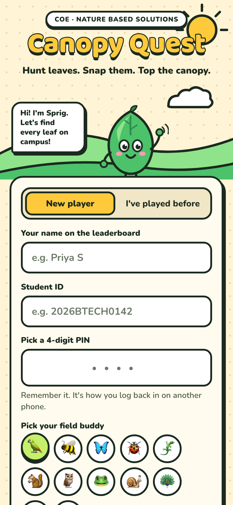
  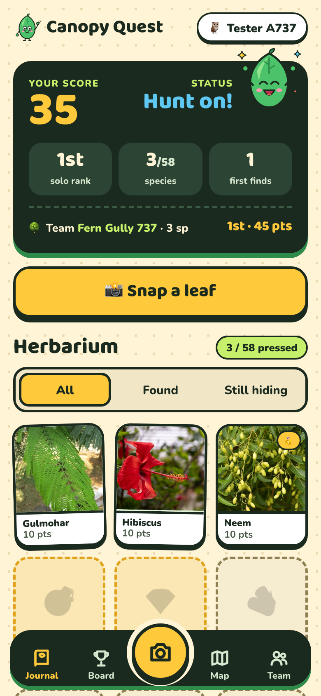
  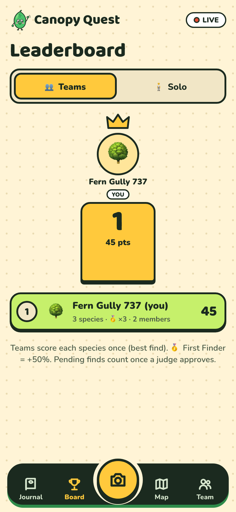
  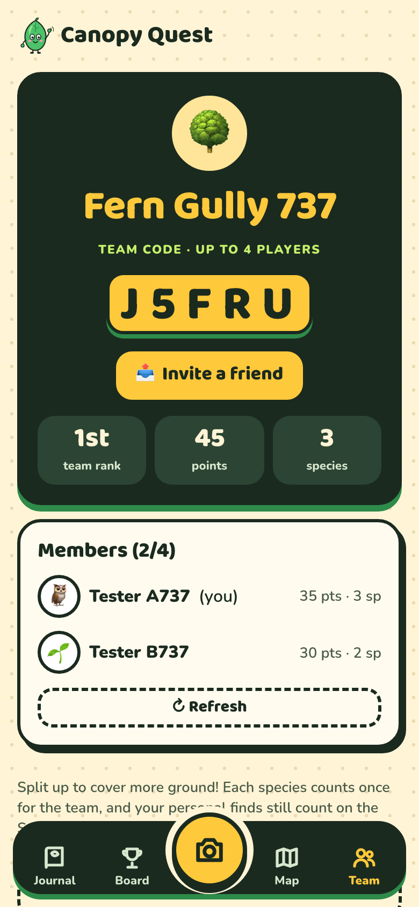

## Sprig

  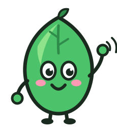
  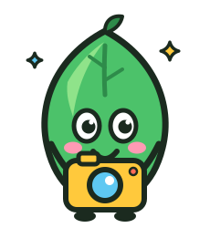
  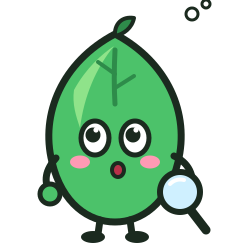
  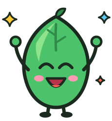

Sprig is a leaf with big eyes, rosy cheeks and a little sprout on top. Its mood tells the player what's happening:

| Mood | Where |
|---|---|
| **Wave** | Welcome screen ("Hi! I'm Sprig. Let's find every leaf on campus!"), empty states, the logo, the projector header |
| **Snap** | The camera screen, saved-offline uploads, the projector's empty feed |
| **Think** | "Not sure? Ask Sprig", while the AI is identifying, finds waiting for a judge, the frozen leaderboard |
| **Cheer** | Points landing, first finds, projector celebrations |

All the art is hand-built SVG (`public/art/`), so it stays crisp on any screen and weighs a few KB. Sprig is also the favicon and the home-screen icon.

## Leaf stickers

  
  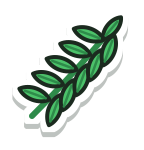
  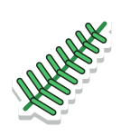
  
  
  
  
  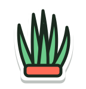
  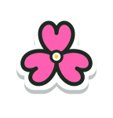
  

Ten sticker-style plant illustrations with a white die-cut edge and a soft drop shadow, used in the mockups and the design language.

## Tokens

| | |
|---|---|
| **Ground** | Cream `#FFF4D6` with a faint dotted grid, like field-notebook paper |
| **Ink** | `#1B2A1F`, a near-black green used for every outline, shadow and body text |
| **Leaf** | `#4CC26A` · dark leaf `#2E8B4A` · lime `#C6F06B` |
| **Accents** | Sun `#FFC93C` (primary actions, scores) · sky `#5EC8F2` (countdowns, solo) · coral `#FF6B57` (LIVE, warnings) · pink `#FF9AB4` (cheeks, teams) |
| **Display type** | Baloo 2, extra bold. Headline numbers get a 3 px ink stroke and a hard drop shadow so they pop. |
| **Body type** | Nunito, 600–900 |
| **Handwriting** | Patrick Hand, for polaroid captions and unlocked facts |
| **Shape** | 3 px ink borders, 16–26 px corner radius, hard offset shadows (no blur), buttons that press down when tapped |

Text on coloured fills is always ink, never white, so it passes contrast on sun, sky and leaf alike.

## Signature pieces

- **The score card:** a dark ink panel with the score in stroked sun yellow, the countdown in sky blue, and Sprig peeking over the top edge.
- **The herbarium:** found plants are white cards with your photo, slightly tilted like pasted prints. Unfound plants are dashed silhouettes with a riddle. Legendary ones get a gold edge.
- **The WANTED poster:** a sun-yellow card with diagonal stripes, a tilted sticker of the species, and a big white "×2" with an ink outline.
- **The geotag stamp:** a dark band burned into every photo with the species, coordinates, accuracy, time, player and team, plus a "GEOTAGGED · CoE NBS" tag.
- **The reward screen:** a sunburst, a FIRST ON CAMPUS ribbon, a huge stroked "+15", your photo as a taped polaroid, and Sprig cheering in a speech bubble.
- **The bottom bar:** an ink pill with stroke icons and a raised sun-yellow camera button in the middle, so the main action is always one thumb away.
- **The projector:** dark forest background so it reads in a lit hall, cream panels, the stroked title, a blinking LIVE badge, coloured stat tiles, and a sun-yellow ticker along the bottom.
- **Landmark signboards:** little wooden signs ("LC 2") on a post, standing on the map.

## Motion

Small and purposeful: the camera button pulses gently, points pop in with a bounce, confetti for finds (a longer burst for first finds and legendary plants), pins drop onto the map as they arrive, leaderboard rows slide when ranks change, and Sprig bobs while the AI is thinking. All of it switches off when the phone asks for reduced motion.
