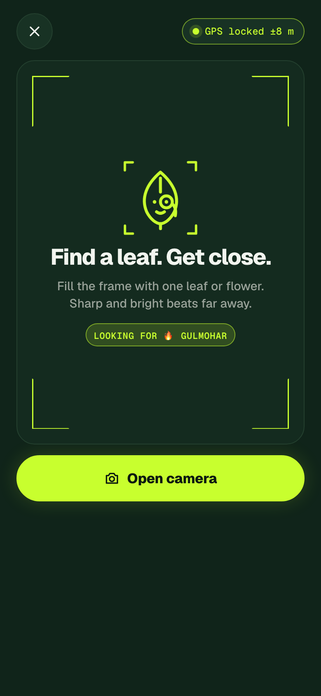
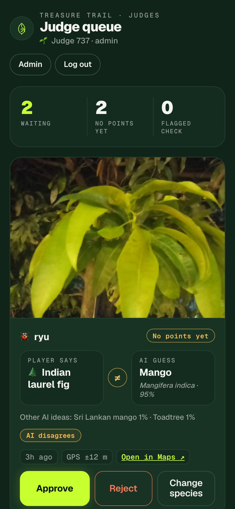
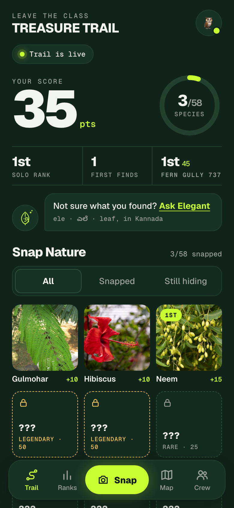
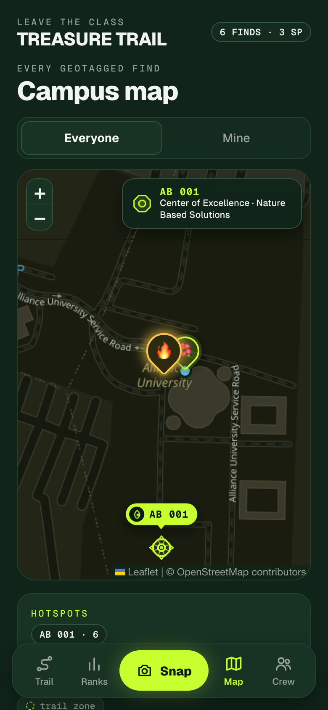
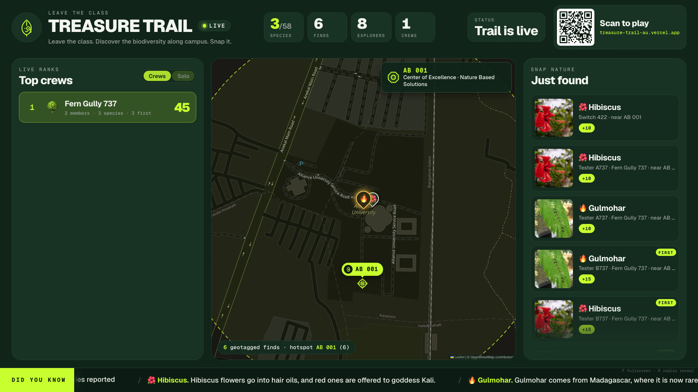

# How it works

Everything a player, judge or organiser sees in TREASURE TRAIL, and the rules underneath.

## 1. Joining

- Students scan the QR poster and land on the site. No install.
- **New player:** a leaderboard name (2–24 characters), their student ID, a 4-digit PIN, and a "field buddy" avatar.
- **Coming back on another phone:** student ID + PIN. Eight wrong PINs in a row lock that ID for 10 minutes.
- **Crews are optional.** Anyone can start a crew (name + emoji) and gets a 5-character crew code. Up to 4 players per crew. Everyone is always on the Solo board, and crew members also count toward the Crews board. Leaving a crew takes your finds with you; an empty crew disappears.

## 2. Snapping a find

1. **GPS first.** The Snap screen watches the phone's location continuously. The camera button only unlocks when the GPS chip turns green:
   - the fix is accurate enough (default: within ±80 m), and
   - the student is inside the trail zone (default: a 600 m circle around the campus), and
   - the trail is open.
   If any of these fail, the chip says exactly why ("Outside trail zone (840 m)", "GPS ±120 m, need ±80").
2. **Camera opens from the site.** It's the phone's rear camera, not the gallery, so photos are taken live.
3. **The phone processes the photo before upload:**
   - resizes it to 1600 px and compresses it (a few hundred KB instead of several MB),
   - burns a **geotag stamp** into the bottom: species, coordinates, accuracy, date and time, player and crew, "TREASURE TRAIL · LEAVE THE CLASS",
   - makes a small thumbnail for feeds and maps,
   - computes a 64-bit visual fingerprint of the image for duplicate detection.
4. **Pick the species** from a searchable list (plants already in your journal are greyed out, bounty plants are marked), or choose **"Not sure? Ask Elegant"** and let the AI name it.
5. **Upload.** The photo, GPS fix and capture time go to the server together.

## 3. What the server checks

In order, before anything is stored:

| Check | Rule |
|---|---|
| Capture time | Within the last 6 hours and not in the future. Not before the trail opened. Not after it closed (uploads get a 30-minute grace period for patchy signal). |
| GPS quality | Accuracy at or under the limit set by organisers. |
| Trail zone | Inside the geofence circle, if it's switched on. |
| Rate limit | At most 4 uploads per player per minute. |
| Duplicate photo | Compared against every accepted photo's fingerprint. The same player re-uploading → refused. A photo that matches **another** player's → accepted but flagged and sent to the judges. |
| Already found | A species counts once per player. Re-submitting one already in your journal → refused with "Find something new!" |

Organisers and judges skip the time, GPS and zone checks so they can test from anywhere.

## 4. AI verification and judging

The photo is sent to **Pl@ntNet**'s identification API, which returns its top 5 guesses with confidence scores. The server gives it 12 seconds.

**If the player picked a species:**
- The AI's top 3 include that species (or an accepted alternative name) with at least 8% confidence → **provisional**: points land instantly.
- Otherwise → **pending**, flagged "AI disagrees", "AI saw no plant" or "AI offline". No points until a judge approves.

**If the player chose "Not sure":**
- The first AI guess with at least 20% confidence that's on our species list becomes the species → **provisional**.
- An AI guess that isn't on our list → pending, flagged "Not on list", for a judge to name.

**Judges** see a queue of every pending find plus any provisional find carrying a flag. Each card shows the photo (tap to enlarge), what the player claimed, the AI's guess and confidence, the AI's other ideas, flags, how long ago, GPS accuracy, the nearest campus landmark, and an "Open in Maps" link. One tap to **Approve**, **Reject** (with an optional note the player sees), or **Change species**. The queue refreshes every few seconds and works on a phone.

Judges can also overturn provisional finds at any time. Scores recompute instantly, including who gets First Finder.

**AI switch.** If the AI runs out of daily checks or misbehaves, an admin flips one switch. From then on every new photo goes straight to the judges (flagged "Manual mode"), and the "Ask Elegant" option disappears from phones with a short explanation. Flip it back and instant points return. Even without the switch, an AI failure never blocks an upload; the photo just goes to the judges.

## 5. Scoring

| | Points |
|---|---|
| Common | 10 |
| Rare | 25 |
| Legendary | 50 |
| **First Finder**: first accepted find of that species on campus, by upload time | +50% |
| **Bounty**: photo taken while a bounty on that species is live | × the bounty's multiplier (usually ×2) |

- **Solo score:** each species you've found, counted once, at its best value.
- **Crew score:** each species found by **any** member, counted once, at the best value any member got. Splitting up pays.
- Only provisional and approved finds count. Pending finds count the moment a judge approves them.
- First Finder isn't stored, it's computed. If a judge rejects the first find of a species, the bonus passes to the next valid one automatically.

## 6. The Trail home and Snap Nature

- **Score card:** your score, a ring showing species snapped out of 58, solo rank, first finds, and your crew's rank and score, with a countdown to the end of the trail.
- **Bounty card** when a bounty is live. Tap it to jump straight to Snap with that species pre-selected.
- **Ask Elegant:** a prompt to let the AI name a plant you can't identify.
- **Snap Nature:** every species as a tile. Snapped ones show your photo; locked ones are dashed tiles with a **riddle** ("Touch me and I fold my leaves shut in a second"). Legendary ones have a gold edge. A small badge shows how many other explorers have already found it.
- **Species sheet:** tap any card for the riddle (if unfound) or the **fun fact** (once found), its tags (native, medicinal, pollinator, invasive, fruit, sacred, shade), and who found it first.
- **Judge status:** finds waiting for a judge (tagged JUDGING), mystery plants, and rejected finds with the judge's note.

### Badges

Bragging rights only, no points: First Sprout, Ten Down, Tree Hugger (8 trees), Herbalist (4 medicinal), Pollinator Pal (4 pollinator plants), Homegrown (6 native), Invasion Spotter (2 invasive), Sharp Eye (a rare find), Legend (a legendary find), Trailblazer (a first find), Treasure Seeker (a bounty find), Speed Run (3 finds in 5 minutes), Explorer (finds 300 m apart), Temple Garden (3 sacred plants), Fruit Basket (4 fruit trees), Botanist (20 species).

## 7. Maps and landmarks

- Every accepted find is a pin on the dark campus map. Gold pins are first finds, lime pins are yours, the blue dot is you, and the dashed lime ring is the trail zone.
- **Landmarks.** OpenStreetMap doesn't name the campus buildings, so organisers place them (Learning Centre 1, Library, Cafeteria…) on a satellite view in the admin panel. They show as small signboards on every map. Each find is tagged with the nearest landmark within 250 m ("Neem · near LC 2"), which appears in the projector feed, map popups, the judge queue and the export. The busiest landmarks become **hotspots** on the projector.
- **The CoE headquarters (AB 001)** is a featured landmark: instead of a signboard it's drawn as a to-scale sketch of its octagonal building (traced from satellite imagery), so it grows as you zoom in. A small floating **AB 001** tag sits on top, and a legend in the corner of the map names it: Centre of Excellence · Nature Based Solutions.

## 8. Live moments

- **Bounties.** An organiser picks a species, a multiplier (×1.5 to ×5) and a duration (1 to 120 minutes). It appears on every phone and on the projector with a countdown. Only photos taken during the window get the multiplier.
- **Freeze.** In the final stretch, organisers freeze the leaderboard. Phones and the projector show a lock; players keep scoring in secret. Scores shown are as of the moment of the freeze.
- **Reveal.** Unfreezing plays a countdown on the projector: crews revealed from 5th up to 1st, then confetti.

## 9. The projector

`/live` on the big screen, no login needed:

- header with LEAVE THE CLASS over TREASURE TRAIL, a pulsing LIVE badge, species found out of the total, finds, explorers, crews, the trail countdown and a **Scan to play** QR code,
- the Crews leaderboard, switching to Solo every 15 seconds, with rows sliding when ranks change,
- the dark campus map with pins popping in as finds arrive, landmarks, the HQ building sketch, and the current hotspot,
- a "Just found" feed of the latest photos with FIRST tags, a gold glow for legendary plants, and bounty tags,
- celebrations with Elegant cheering for first finds and legendary plants,
- a ticker of fun facts about species found so far, and nature-based-solution counts (native species found, pollinator plants mapped, medicinal plants logged, invasive species reported),
- keyboard: **F** for fullscreen, **R** to replay the reveal.

## 10. When the signal drops

If an upload fails because there's no connection, the find (photo, GPS fix and capture time) is saved in the phone's browser storage. The Trail home shows "1 find waiting for signal" and retries every 20 seconds and whenever the phone comes back online. Because the server checks the original capture time, a find taken during the trail still counts if it uploads a little after.

## 11. After the trail

Organisers export every find as **CSV** (for spreadsheets) or **GeoJSON** (drops straight into QGIS, Google My Maps or geojson.io): time, species (common and scientific), status, coordinates, GPS accuracy, nearest landmark, player, student ID, crew, photo link and the AI's guess and confidence. That's the campus plant inventory.
